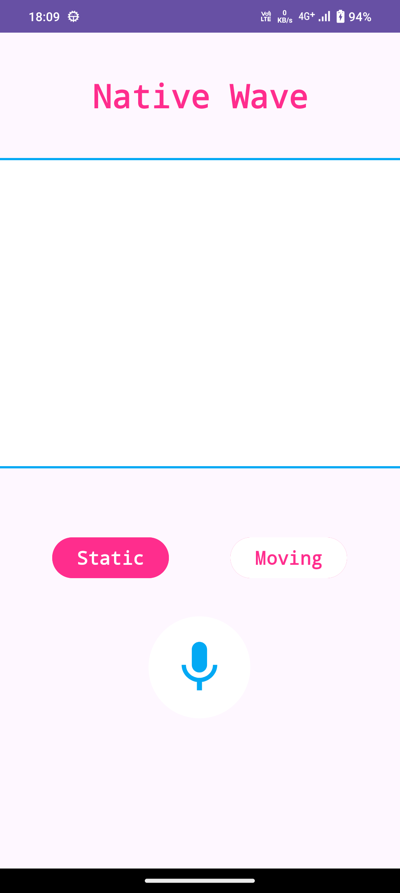
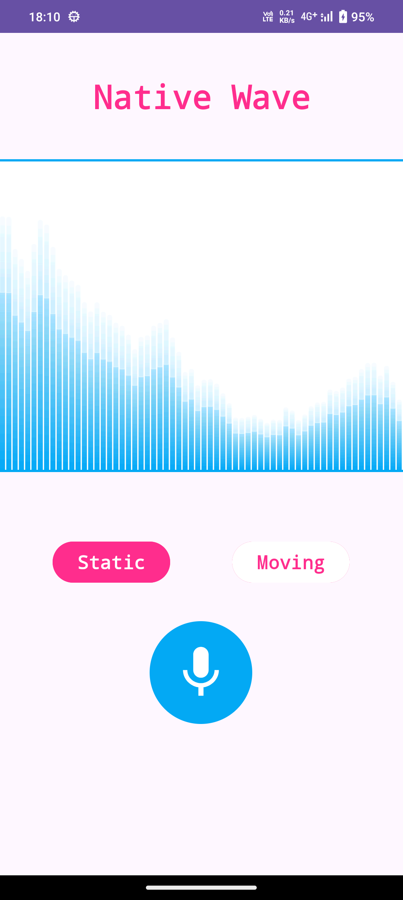
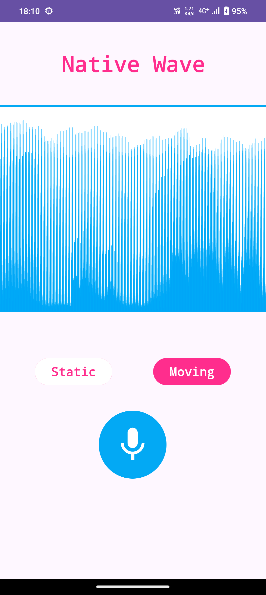

# NativeWave

**NativeWave** is a high-performance Android application that captures real-time microphone audio, computes Fast Fourier Transforms (FFT) natively in C++ via Java Native Interface (JNI), and renders customizable 60 FPS spectrum and waveform visualizations using a custom `SurfaceView`.

---

## 📱 Screenshots

<p align="center">
  
  
  
</p>

---

## 🌟 Key Features

- **Real-Time Audio Capture**: Low-latency PCM audio recording using Android's `AudioRecord` API.
- **Native FFT Computation**: Fast, low-overhead frequency analysis performed in C++ using the [KissFFT](https://github.com/mborgerding/kissfft) library over JNI.
- **Custom SurfaceView Visualizer**: Hardware-accelerated 60 FPS rendering in a dedicated drawing thread.
- **Dual Display Modes**:
  - **Static Mode**: Glassmorphic vertical frequency bar equalizer with linear gradients, shine highlights, and smooth rounding.
  - **Moving Mode**: Continuous real-time waveform stream scrolling smoothly from right to left.
- **Audio Signal Preprocessing**: Hanning windowing to eliminate spectral leakage and exponential smoothing for fluid motion.

---

## 📐 App Design & Architecture

The application follows a clean modular pipeline starting from raw hardware audio sampling down to native C++ computation and hardware-accelerated UI rendering.

```
+-------------------+       +-----------------------+       +-------------------+
|  Audio Capture    | ----> | Signal Preprocessing  | ----> | Native C++ (JNI)  |
|  (AudioRecord)    |       |  (Hanning Windowing)  |       |     (KissFFT)     |
+-------------------+       +-----------------------+       +-------------------+
                                                                      |
+-------------------+       +-----------------------+                 |
|  Custom UI Render | <---- |   Smoothing & dB      | <---------------+
| (SurfaceView 60FPS|       |    Log Scaling        |
+-------------------+       +-----------------------+
```

### 1. Audio Capture & Preprocessing (Kotlin)
- **Class**: `AudioRecorder.kt`
- **Audio Capture**: Captures 16-bit PCM audio chunks (1024 samples frame size) from the device microphone at a 44.1 kHz sample rate.
- **Normalization**: Converts raw `ShortArray` audio samples into floats normalized to `[-1.0, 1.0]`.
- **Hanning Windowing**: Applies a Hanning window function ($0.5 \cdot (1 - \cos(2\pi \cdot i / (N - 1)))$) to raw audio frames to minimize edge discontinuities and spectral leakage prior to FFT transform.

### 2. Native C++ Layer & JNI (`native-lib.cpp` & `KissFFT`)
- **Native Integration**: Configured in `CMakeLists.txt` using C++ and CMake.
- **JNI Bridge**: Exposes `external fun performFFT(input: FloatArray): FloatArray` in `AudioRecorder.kt`, bound to `Java_com_ripalnakiya_nativewave_AudioRecorder_performFFT` in C++.
- **KissFFT Engine**:
  - Builds complex input vectors ($in.r = \text{audio sample}, in.i = 0$).
  - Invokes `kiss_fft(...)` to perform 1024-point complex FFT.
  - Calculates magnitude for each frequency bin: $\text{magnitude} = \sqrt{r^2 + i^2}$.
  - Returns the float array back across the JNI boundary to Kotlin.

### 3. Logarithmic Scaling & Post-Processing (Kotlin)
- Extracts the non-redundant positive frequency half of the FFT spectrum (`copyOfRange(0, fftSize / 2)`).
- Converts raw magnitudes to a decibel ($\text{dB}$) logarithmic scale:
  $$\text{dB} = 20 \cdot \log_{10}(\text{magnitude} + 1e-6)$$
- Passes normalized decibel values to `WaveformSurfaceView`.

### 4. Rendering & Custom View (`WaveformSurfaceView.kt`)
- **Engine**: Implements a dedicated drawing thread using `SurfaceHolder.Callback` and `lockCanvas()` / `unlockCanvasAndPost()`, targeting ~60 FPS (16ms draw loop).
- **Temporal Smoothing**: Uses exponential moving average smoothing ($\alpha = 0.2$) on frequency data to prevent jittery visuals.
- **Natural Decay**: Automatically decays spectrum values toward minimum decibel thresholds when recording stops.
- **Render Modes**:
  - **`STATIC`**: Renders 64 grouped frequency bars using `Path` and `RectF`. Styled with custom `LinearGradient` shaders for a glassmorphism aesthetic, top highlight shines, and semi-transparent top borders.
  - **`MOVING`**: Draws onto an offscreen `Bitmap` canvas, shifting existing pixels left by a frame offset while appending new frequency slices on the right side to create a continuous scrolling audio stream.

---

## 🛠️ Tech Stack

- **Language**: Kotlin & C++
- **Build System**: Gradle (Kotlin DSL) with CMake for external native builds
- **NDK / JNI**: Android NDK with JNI interface
- **DSP Engine**: [KissFFT](https://github.com/mborgerding/kissfft) (v131.2.0)
- **UI Framework**: Android Views, `SurfaceView`, Canvas, ViewBinding, Material Components
- **Min SDK**: 24 (Android 7.0)
- **Target SDK**: 36

---

## 🚀 Getting Started

### Build & Run
1. Clone the repository:
   ```bash
   git clone https://github.com/ripalnakiya/NativeWave.git
   cd NativeWave
   ```
2. Open the project in Android Studio.
3. Ensure NDK and CMake paths are configured in Android Studio settings.
4. Sync project with Gradle files and run on your connected device/emulator.

---

## 📄 License

This project incorporates the open-source [KissFFT](https://github.com/mborgerding/kissfft) library (BSD 3-Clause / Unlicense).
